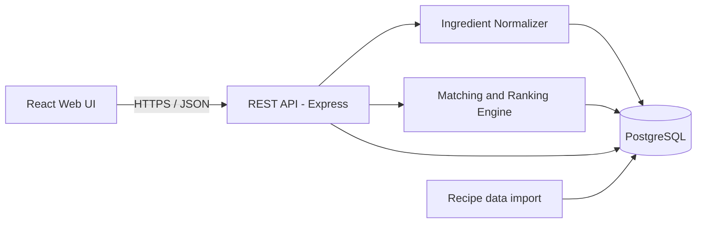

# CookMatch: Integration Guide

How the parts of CookMatch connect: frontend to API, API to the matching engine and database, and how to bring in recipe data and add outside services later. It matches the layers in the architecture file and the endpoints in `api.md`.

> Technology names, folder names and values are proposed defaults. Adjust them to the final implementation.

---

## 1. Integration Overview

CookMatch has four parts that must work together:



| Connection | Protocol | Purpose |
| --- | --- | --- |
| UI to API | HTTPS, JSON, `Authorization: Bearer` header | All user actions |
| API to engine modules | Direct function calls inside the server | Normalize names, match, rank |
| API and engine to database | PostgreSQL connection pool | Read and write data |
| Import script to database | Direct SQL or API (admin) | Load recipes and ingredients |

All integration points follow `api.md` as the contract. If the contract changes, update `api.md` first.

---

## 2. Integration Order

Build and connect in this order so each step can be tested before the next one starts.

| Step | What to connect | Done when |
| --- | --- | --- |
| 1 | Database schema and seed data | Matching SQL query returns the expected scores for the test users |
| 2 | Backend connects to the database | Health check endpoint returns OK and a test query works |
| 3 | Authentication (register, login, token middleware) | Protected endpoint rejects a missing token and accepts a valid one |
| 4 | Ingredient normalizer and pantry endpoints | `PUT /pantry` saves normalized ingredient IDs |
| 5 | Matching engine and `/recommendations` | API scores equal the hand-calculated scores |
| 6 | Recipe details, filters, substitutes | Filters and substitutes work with the seed data |
| 7 | Admin endpoints | Admin can add a recipe that then appears in recommendations |
| 8 | Frontend pages connected to the API | Main user journey works end to end |
| 9 | Deployment configuration | Same journey works on the staging server over HTTPS |

---

## 3. Frontend to API

### 3.1 API client

Keep every API call in one place (`client/src/api/`). Components call these helpers and never call `fetch` directly.

```javascript
// client/src/api/client.js
const BASE_URL = process.env.REACT_APP_API_URL || 'http://localhost:5000/v1';

export async function api(path, { method = 'GET', body, token } = {}) {
  const res = await fetch(`${BASE_URL}${path}`, {
    method,
    headers: {
      'Content-Type': 'application/json',
      ...(token ? { Authorization: `Bearer ${token}` } : {}),
    },
    body: body ? JSON.stringify(body) : undefined,
  });

  if (res.status === 204) return null;
  const data = await res.json();
  if (!res.ok) throw Object.assign(new Error(data.error?.message), data.error, { status: res.status });
  return data;
}
```

```javascript
// client/src/api/recommendations.js
export const getRecommendations = (token, filters) => {
  const params = new URLSearchParams(filters).toString();
  return api(`/recommendations?${params}`, { token });
};
```

### 3.2 Screen to endpoint map

| Screen | Calls |
| --- | --- |
| Register / Log in | `POST /auth/register`, `POST /auth/login` |
| Enter ingredients | `GET /ingredients/search`, `PUT /pantry`, `GET /pantry` |
| Recommendations | `GET /recommendations`, `GET /cuisines`, `GET /dietary-tags` |
| Recipe details and cooking | `GET /recipes/{id}` |
| Admin (recipes) | `POST/PUT/DELETE /recipes`, `POST /ingredients`, `POST /substitutes` |

### 3.3 Error and token handling

| Case | Frontend behavior |
| --- | --- |
| `401 TOKEN_INVALID` | Clear the token, go to the login page, show "Please log in again" |
| `403 FORBIDDEN` | Show "You do not have access" and hide admin features |
| `422 UNKNOWN_INGREDIENT` | Highlight the unknown names from `details` and let the user fix them |
| `400 VALIDATION_ERROR` | Show each message from `details` next to its field |
| `409 DUPLICATE` | Show a clear message such as "Already in your pantry" |
| `500` or network failure | Show a friendly retry message; keep the user's input |

### 3.4 Smooth use

- Debounce ingredient search (about 250 ms) and ignore out-of-date responses.
- After `PUT /pantry` succeeds, re-fetch recommendations.
- Keep filter values in the page URL so results can be shared and refreshed.
- Show loading states and the empty-pantry hint from the API.

---

## 4. API to Matching Engine

The matching engine is a separate module, so it can be changed without touching the routes (NFR-10). The API passes in the user ID and filters, and gets back ranked results.

### 4.1 Module contract

```javascript
// server/src/services/matcher.js
/**
 * @param {number} userId
 * @param {{ cuisineId?: number, maxTime?: number, diet?: string,
 *           almostOnly?: boolean, minScore?: number, page: number, limit: number }} filters
 * @returns {Promise<{ items: RankedRecipe[], totalItems: number }>}
 */
async function getRecommendations(userId, filters) { /* ... */ }

module.exports = { getRecommendations, calculateMatchScore, rankRecipes, isAlmostAchievable };
```

```javascript
// server/src/routes/recommendations.js
router.get('/recommendations', authenticate, validateFilters, async (req, res, next) => {
  try {
    const result = await matcher.getRecommendations(req.user.sub, req.filters);
    res.json(toRecommendationResponse(result, req.filters));
  } catch (err) { next(err); }
});
```

### 4.2 Rules

- Routes handle HTTP only (read the request, call a service, send the response).
- Services hold the business logic and know nothing about HTTP.
- The user ID always comes from the verified token (`req.user.sub`).
- Settings such as the expiry window come from configuration, not from hard-coded values.
- Keep the ranking order in one place: score (high to low), expiring count (high to low), cooking time (low to high), recipe ID.

### 4.3 Normalizer contract

```javascript
// server/src/services/normalizer.js
/** Returns { ingredientId, name } or null when no ingredient or alias matches. */
async function normalizeIngredient(text) { /* ... */ }

/** Returns { resolved: [...], unknown: [...] } for a list of items. */
async function normalizeMany(items) { /* ... */ }
```

`PUT /pantry` calls `normalizeMany`. If `unknown` is not empty, it returns `422 UNKNOWN_INGREDIENT` and saves nothing.

---

## 5. API and Engine to Database

### 5.1 Connection

```javascript
// server/src/db/index.js
const { Pool } = require('pg');
const pool = new Pool({ connectionString: process.env.DATABASE_URL, max: 10 });

module.exports = { query: (text, params) => pool.query(text, params), pool };
```

### 5.2 Rules

| Rule | Reason |
| --- | --- |
| Use parameterized queries only (`$1`, `$2`) | Prevents SQL injection |
| Use a connection pool | Handles 50 or more concurrent users (NFR-2) |
| Use a transaction when several tables change together | Recipe create, update and delete touch recipes, ingredients, steps and tags; all must succeed or none |
| Replace the pantry in one transaction | Delete and insert together so a failure never leaves a half-saved pantry |
| Map database errors to API errors | `23505` to `409 DUPLICATE`, `23503` to `404 NOT_FOUND`, anything else to `500` |

```javascript
// Replace the pantry inside one transaction
const client = await pool.connect();
try {
  await client.query('BEGIN');
  await client.query('DELETE FROM pantry_items WHERE user_id = $1', [userId]);
  for (const item of items) {
    await client.query(
      'INSERT INTO pantry_items (user_id, ingredient_id, expiry_date) VALUES ($1, $2, $3)',
      [userId, item.ingredientId, item.expiryDate || null]
    );
  }
  await client.query('COMMIT');
} catch (err) {
  await client.query('ROLLBACK');
  throw err;
} finally {
  client.release();
}
```

### 5.3 Migrations

Keep schema changes as numbered migration files so every team member gets the same database.

```
server/src/db/migrations/
  001_create_users.sql
  002_create_ingredients.sql
  003_create_recipes.sql
  004_create_pantry_and_substitutes.sql
  005_add_indexes.sql
```

Never edit an old migration that others already ran. Add a new one.

---

## 6. Data Integration: Loading Recipes and Ingredients

The quality of recommendations depends on the data (a stated project limitation), so loading data is an integration task of its own.

### 6.1 Sources

| Source | Notes |
| --- | --- |
| Team-written starter set | Safest option; a small reviewed set of recipes, ingredients, aliases and substitutes |
| Public or open recipe datasets | Check the license and allowed use before copying data |
| Admin endpoints | For adding and fixing single recipes after launch |

Do not copy recipe text from websites without permission. Use open data with a suitable license, or write the recipes yourselves.

### 6.2 Import steps

1. **Collect** recipes in a simple file format (CSV or JSON).
2. **Clean** ingredient names: lowercase, trim spaces, remove amounts and units (CookMatch matches presence only).
3. **Map** each name to an ingredient or alias; create missing ingredients and aliases.
4. **Load** in a transaction: ingredients, aliases, recipes, `recipe_ingredients`, steps, tags.
5. **Check** the import: count rows, look for recipes with no ingredients, and run a few hand-checked matching queries.

### 6.3 Sample import format

```json
{
  "title": "Fried Rice",
  "cuisine": "Bangladeshi",
  "cookingTimeMin": 20,
  "dietaryTags": ["Vegetarian"],
  "ingredients": ["rice", "egg", "butter", "onion", "salt"],
  "steps": [
    "Heat the oil in a pan.",
    "Add the egg and scramble lightly.",
    "Add the rice and stir for 3 minutes."
  ]
}
```

### 6.4 Data quality checks

- No recipe without ingredients or steps.
- No duplicate ingredient names or aliases.
- Every substitute points to two existing, different ingredients.
- Common regional names are added as aliases (limitation 5 in the proposal).

---

## 7. Configuration and Environments

| Setting | Development | Staging / Production |
| --- | --- | --- |
| API URL (frontend `REACT_APP_API_URL`) | `http://localhost:5000/v1` | `https://api.<your-domain>/v1` |
| `DATABASE_URL` | Local PostgreSQL | Private database, restricted access |
| `JWT_SECRET` | Any dev value | Long random secret, different from development |
| `JWT_EXPIRES_IN` | `1h` | `1h` |
| `EXPIRY_WARNING_DAYS` | `3` | `3` |
| CORS allowed origin | `http://localhost:3000` | The real frontend URL only |
| HTTPS | Optional | Required |

Each environment has its own `.env`. Never commit real secrets.

---

## 8. Running Everything Together

```bash
# Terminal 1: database (if not already running)
pg_ctl start

# Terminal 2: backend
cd server && npm run dev        # http://localhost:5000

# Terminal 3: frontend
cd client && npm start          # http://localhost:3000
```

### 8.1 Smoke test (run after every integration change)

| Step | Check | Expected |
| --- | --- | --- |
| 1 | `GET /v1/health` | `200 OK` |
| 2 | Register and log in with a test account | Token returned |
| 3 | `PUT /pantry` with Egg, Onion, Tomato, Oil, Salt | `200 OK`, 5 items saved |
| 4 | `GET /recommendations` | Tomato Egg Curry at 100% |
| 5 | `GET /recipes/{id}` | Full recipe with steps |
| 6 | Open the web UI and repeat steps 2 to 5 | Same results as the API |

---

## 9. Deployment Integration

| Part | Proposed approach |
| --- | --- |
| Frontend | Build static files (`npm run build`) and host on any static host or the same server |
| Backend | Run Node.js behind a reverse proxy such as Nginx, with HTTPS |
| Database | Managed or self-hosted PostgreSQL, not open to the internet |
| Secrets | Environment variables set on the server |
| Backups | Regular database backups, stored privately |
| CI | On every commit: install, lint, unit tests, integration tests with a test database |

### 9.1 CI pipeline outline

```yaml
# .github/workflows/ci.yml (outline)
name: CI
on: [push, pull_request]
jobs:
  test:
    runs-on: ubuntu-latest
    services:
      postgres:
        image: postgres:14
        env: { POSTGRES_PASSWORD: test, POSTGRES_DB: cookmatch_test }
        ports: ['5432:5432']
    steps:
      - uses: actions/checkout@v4
      - uses: actions/setup-node@v4
        with: { node-version: 18 }
      - run: cd server && npm ci
      - run: cd server && npm run migrate && npm run seed:test
      - run: cd server && npm test
      - run: cd client && npm ci && npm test -- --watchAll=false
```

---

## 10. Future Integrations

These are not in the first version. Plan the extension points now so adding them later is easy.

| Feature | How it could connect | Prepare now by |
| --- | --- | --- |
| Personalized recommendations | New service reads past choices and adjusts ranking | Keep ranking inside the matcher module with one sorting function |
| Nutrition information | External nutrition API or dataset linked to ingredients | Keep ingredient IDs stable; treat results as approximate |
| Image-based ingredient recognition | Image upload to a vision service that returns ingredient names, which go through the normalizer | Keep the normalizer as the single entry point for ingredient names |
| Quantity-aware matching | Add `quantity` and `unit` to `recipe_ingredients` and `pantry_items` | Keep the match calculation in one function; version the API if responses change |
| Email (password reset, verification) | Email service called from the auth module | Keep auth logic in its own module |
| Grocery list for missing items | New endpoint using `missingIngredients` from the recommendation result | Keep missing items in the recommendation response (already included) |

---

## 11. Integration Checklist

- [ ] Schema and seed data load cleanly on a fresh database.
- [ ] The matching SQL gives the hand-calculated scores for the test users.
- [ ] The backend connects to the database and exposes a health check.
- [ ] Token middleware and role middleware are on all protected routes.
- [ ] All endpoints match `api.md` (paths, fields, status codes, error format).
- [ ] The frontend reads the base URL from configuration.
- [ ] The frontend handles every error code in section 3.3.
- [ ] CORS allows only the real frontend origin.
- [ ] Multi-table changes run inside transactions.
- [ ] The data import runs without errors and passes the quality checks.
- [ ] The smoke test passes locally and on staging.
- [ ] CI runs unit and integration tests on every push.
- [ ] README setup steps work on a clean machine.

---

## 12. Common Integration Problems

| Problem | Likely cause | Fix |
| --- | --- | --- |
| Browser shows a CORS error | Backend does not allow the frontend origin | Set the allowed origin in the CORS configuration |
| UI works with curl but not in the browser | CORS, wrong base URL, or missing header | Compare the request in the network tab with the curl request |
| `401` on every call after login | Frontend not sending the `Authorization` header | Check the API client; check where the token is stored |
| Frontend and API disagree on field names | `camelCase` vs `snake_case` | Convert database column names to `camelCase` in one place (the response mapper) |
| Recommendations empty after adding ingredients | Pantry saved raw text instead of ingredient IDs | Normalize names before saving |
| Works locally, fails on the server | Different `.env`, HTTPS, or database version | Compare environment values and versions |
| Recipes added by the admin never appear | Recipe has no ingredient links, or the pantry has no overlap | Check `recipe_ingredients` rows for the recipe |
| Slow responses after importing many recipes | Missing indexes | Add the indexes from the design file; run `EXPLAIN ANALYZE` |

For deeper troubleshooting, see `Debugging.md`.

---

## 13. Related Documents

| Document | Contents |
| --- | --- |
| `api.md` | Endpoint contract used by every integration |
| `cookmatch_architecture_and_database.md` | Architecture, diagrams, schema and queries |
| `Authentication_and_Security.md` | Token, role and security rules |
| `Debugging.md` | How to find and fix problems |
| `testing_and_qa.md` | Test cases for each integration point |
| `README.md` | Setup and project overview |
