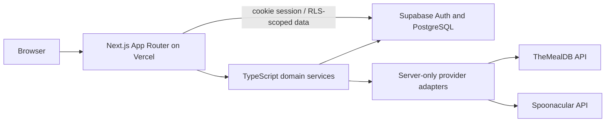

# CookMatch: Integration Guide

This guide describes how the Next.js application, Supabase, recipe providers and Vercel fit together. Read `implementation.md` for the authoritative build sequence and provider restrictions.

## 1. Integration overview

Keep matching, ingredient normalization and provider response normalization in server-side TypeScript modules. Browser components must not contain provider API keys or call paid providers directly.

## 2. Integration sequence

1. Scaffold strict TypeScript Next.js App Router and Tailwind CSS.
2. Configure Supabase development project, Auth SSR cookies, SQL migrations and RLS.
3. Verify user isolation and admin policy before building product mutations.
4. Implement canonical ingredient search and atomic pantry operations.
5. Implement provider adapters and confirm terms/quotas before any import or caching.
6. Implement deterministic recipe scoring, filtering and details against normalized data.
7. Build the responsive user and admin UI.
8. Configure Vercel preview/production environments and Supabase redirect URLs.
9. Verify all high-priority SRS requirements against a deterministic local/demo catalog.

## 3. Next.js data access

Use Server Components for initial reads and Server Actions or Route Handlers for mutations. Create separate Supabase clients for browser and server contexts using `@supabase/ssr`. The server must validate the signed-in user; RLS must still enforce row ownership. Keep direct database access behind feature/service functions so UI does not encode RLS or matching policy.

The endpoint shapes in `API.md` are logical contracts for Route Handlers if exposed. The first-party UI may use Server Actions instead of making every interaction call a REST endpoint. Do not add a separate Express service.

## 4. Supabase and migrations

- Check in every schema change under `supabase/migrations/`.
- Apply migrations to a disposable development/test project before production.
- Seed deterministic demo data only in development/test.
- Enable RLS for every exposed table and test with anonymous, user A, user B and admin identities.
- Use UUID references to `auth.users` for profile and pantry ownership. Keep catalog IDs consistent with the selected schema.
- Generate Supabase TypeScript types after schema changes.
- Never commit project keys. Never expose the service-role key to browser code.

## 5. Recipe data providers

Implement TheMealDB and Spoonacular as separate adapters behind a common internal contract. Each adapter converts source DTOs into validated provider-neutral records. The domain model and matcher must not depend on provider field names.

Before enabling data import, persistent cache, image reuse or public deployment, verify the provider's current terms, pricing/plan, attribution, rate limits and storage rights. Use official APIs and do not scrape provider websites. Store source identifiers, source links and required attribution when allowed. If storage is not permitted, use request-time access within the approved plan and handle quota/provider outages gracefully. Spoonacular calls are metered; do not call it on every UI render or from client components.

Import/sync should be an admin-only or trusted server task, idempotent by provider/source ID, and observable for failed/rejected records. Never overwrite admin-maintained canonical ingredient mappings without an explicit policy. If the available provider plan cannot support exhaustive pantry matching, label the results/provider mode honestly.

## 6. Environments and deployment

| Value | Local | Vercel preview / production |
| --- | --- | --- |
| Next.js URL | `http://localhost:3000` | Vercel preview URL / production domain |
| Supabase URL and publishable key | Development project | Correct environment's project |
| Service-role key | Avoid unless a local trusted job needs it | Server-only Vercel environment variable; never `NEXT_PUBLIC_*` |
| Spoonacular key | Optional; use mocked provider in development/tests | Server-only, monitored for quota usage |
| TheMealDB key | Development test key where allowed | Production/supporter key as required by current terms |
| Auth redirect URLs | localhost callback | Exact preview/production callback URLs configured in Supabase |

Use separate Supabase projects/credentials for development and production. Configure variables in Vercel's environment settings, not in committed files. Production traffic must use HTTPS. Supabase database should not be made publicly reachable through raw connection credentials.

## 7. Provider reliability and caching

- Set request timeouts and handle non-2xx responses, malformed JSON, rate limits and provider downtime.
- Validate remote responses at runtime before using them.
- Cache only fields and for durations permitted by the provider contract/plan. Cache access must happen server-side.
- Provide a clear empty/degraded state rather than leaking provider errors or keys.
- Mock providers in automated checks so tests do not consume paid quota.

## 8. Release integration checklist

- [ ] Fresh checkout can install and start the Next.js application from documented commands.
- [ ] Database migrations apply to a clean Supabase project.
- [ ] RLS prevents cross-user pantry access and user catalog writes.
- [ ] Public registration always creates a regular user; role escalation is blocked.
- [ ] Pantry aliases normalize to canonical ingredient IDs; failed replacement is atomic.
- [ ] Scores, filters, expiry ordering and ties are deterministic.
- [ ] Provider source metadata/attribution is retained wherever permitted.
- [ ] Provider keys and Supabase service-role key are server-only.
- [ ] Vercel preview and production use separate environment configuration.
- [ ] Supabase Auth redirects are configured for local and deployed URLs.
- [ ] No user-facing state implies exhaustive data coverage if provider limits prevent it.

## 9. Common integration issues

| Symptom | Check |
| --- | --- |
| User appears signed out on server render | Confirm `@supabase/ssr` server client and cookie refresh handling |
| User A sees or changes user B's pantry | Stop release; inspect RLS policies and query scoping |
| Admin page visible but writes fail | Verify trusted role provisioning and both server checks and RLS |
| Recipes fail after provider outage | Confirm provider data is behind an adapter and UI has a degraded state |
| Spoonacular quota is exhausted | Reduce duplicate calls, use permitted caching, check plan; avoid browser-per-render calls |
| Preview auth callback fails | Add exact Vercel preview URL to Supabase redirect allow-list |
| Recipe missing ingredient matches | Inspect canonical ingredient mappings and alias normalization |
