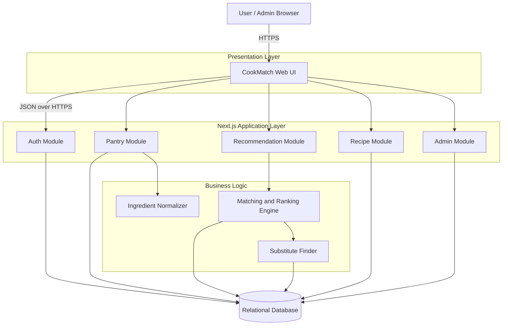
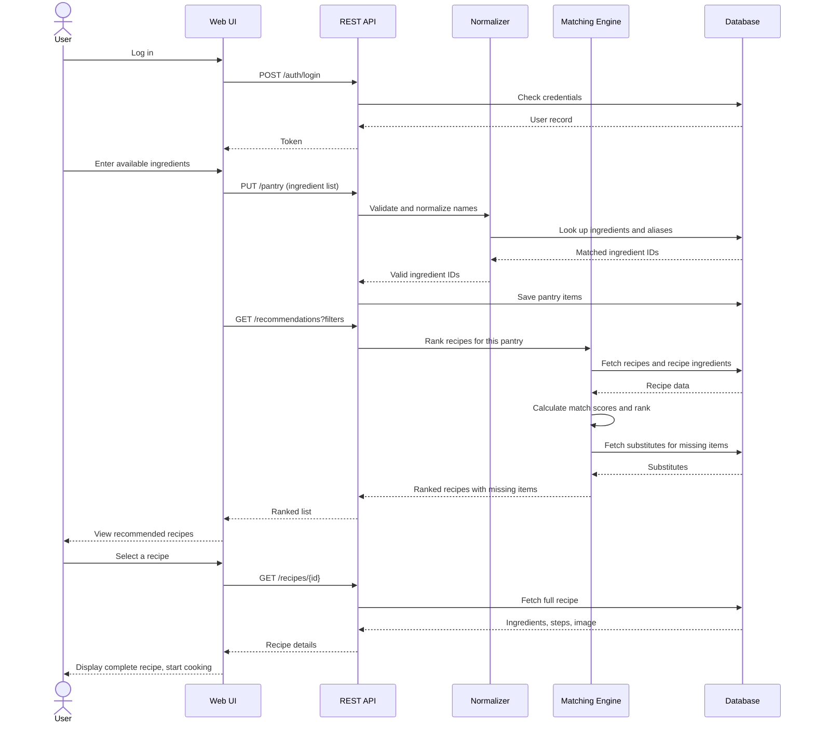
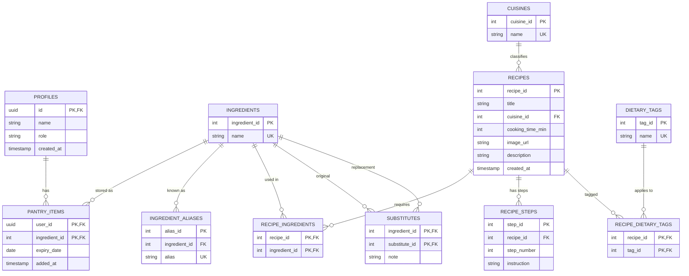

# CookMatch: Architecture and Database Design

A smart recipe recommendation system based on available ingredients.
This document describes the system architecture and the database design that support the requirements in the CookMatch Software Requirements Specification.

> Selected stack: strict TypeScript, Next.js App Router, Tailwind CSS, Supabase PostgreSQL/Auth, and Vercel. See `implementation.md` for implementation instructions. Older schema/query examples are illustrative and must follow the Supabase UUID/RLS changes below.

---

## 1. Architecture Overview

CookMatch uses a layered client-server architecture with four main parts:

| Layer | Responsibility |
| --- | --- |
| Presentation (web UI) | Registration and login, ingredient entry, recommendation list, filters, recipe details |
| API / Application | Receives requests, validates input, handles authentication, calls the services |
| Business logic | Ingredient normalization, matching and ranking engine, substitute lookup, expiry prioritization |
| Data | Relational database storing users, ingredients, recipes, substitutes and pantry data |

### 1.1 Component diagram



### 1.2 Proposed technology stack

| Part | Proposed choice | Reason |
| --- | --- | --- |
| Language | TypeScript, strict mode | Shared typed domain models and safer server/client boundaries |
| Framework | Next.js App Router | Full-stack React app with Server Components, Server Actions and Route Handlers |
| Styling | Tailwind CSS | Utility-first styling; use tokens/components defined in `Design.md` |
| Database | Supabase PostgreSQL | Relational model with migrations, constraints and Row Level Security |
| Authentication | Supabase Auth with `@supabase/ssr` | Cookie-based sessions for Next.js; no custom password table/JWT issuer |
| Hosting | Vercel (app) and Supabase (data/Auth) | Integrated deployment and managed Postgres |
| Recipe data | TheMealDB and Spoonacular APIs | Server-only adapters; comply with provider terms, limits and attribution |

### 1.3 Module responsibilities

| Module | Main duties | Requirements |
| --- | --- | --- |
| Auth | Register, log in, log out, role check (user or admin) | FR-1 to FR-3, NFR-7 |
| Pantry | Add, edit, remove pantry ingredients, store optional expiry date | FR-4 to FR-6 |
| Ingredient Normalizer | Match typed names to database ingredients and aliases, reject unknown names | FR-7 |
| Matching and Ranking Engine | Compute match score, rank recipes, boost expiring-ingredient recipes, flag almost-achievable recipes | FR-8 to FR-13 |
| Substitute Finder | Return substitutes for missing ingredients | FR-14 |
| Recipe | Filter by cuisine, time and diet; return recipe details | FR-15 to FR-19 |
| Admin | Create, update, delete recipes, ingredients, aliases, substitutes | FR-20, FR-21 |

### 1.4 Main request flow (recommend recipes)

This follows the activity flow of the system.



### 1.5 REST API endpoints

| Method | Endpoint | Purpose | Access |
| --- | --- | --- | --- |
| POST | /auth/register | Create an account through Supabase Auth | Public |
| POST | /auth/login | Sign in through Supabase Auth and establish a cookie session | Public |
| GET | /ingredients/search?q= | Suggest ingredient names while typing | User |
| GET | /pantry | Get the current user's pantry | User |
| PUT | /pantry | Replace or update pantry items | User |
| DELETE | /pantry/{ingredientId} | Remove one pantry item | User |
| GET | /recommendations | Ranked recipes for the pantry, with optional filters `cuisine`, `maxTime`, `diet` | User |
| GET | /recipes/{id} | Full recipe details | User |
| POST | /recipes | Create a recipe | Admin |
| PUT | /recipes/{id} | Update a recipe | Admin |
| DELETE | /recipes/{id} | Delete a recipe | Admin |
| POST | /ingredients | Create an ingredient or alias | Admin |
| POST | /substitutes | Create a substitute mapping | Admin |

### 1.6 Matching and ranking algorithm

Quantities are ignored; only presence or absence of an ingredient counts.

```
for each recipe:
    required  = ingredients the recipe needs
    have      = required ingredients found in the user's pantry
    missing   = required minus have
    score     = |have| / |required| * 100
    expiring  = number of "have" ingredients with an expiry date within the warning window

keep recipes that pass the selected filters (cuisine, time, diet)
sort by score descending, then by expiring descending, then by cooking time ascending
mark a recipe "almost achievable" when |missing| is 1 or 2
attach substitutes for each missing ingredient when they exist
```

The warning window for an expiring ingredient (for example 3 days) and the exact weight of the expiry boost are design decisions for the team to set and test.

### 1.7 Security design

| Concern | Approach |
| --- | --- |
| Passwords | Managed and hashed by Supabase Auth; never copied to app tables |
| Sessions | Supabase Auth cookie-based SSR sessions |
| Access control | Server role checks and PostgreSQL RLS on every protected operation |
| Injection | Parameterized queries only; sanitize all user input |
| Transport | HTTPS for all traffic |

### 1.8 Suggested project structure

```
cookmatch/
  src/app/                # Next.js App Router pages and Route Handlers
  src/components/         # Tailwind UI components
  src/features/           # auth, pantry, recommendations, recipes, admin
  src/server/             # TypeScript domain services and provider adapters
  src/lib/supabase/       # Supabase browser/server clients
  supabase/migrations/    # SQL schema, constraints and RLS policies
  supabase/seed.sql       # local/demo data
  docs/
```

---

## 2. Database Design

A relational design in Supabase PostgreSQL. Names use snake_case. Supabase Auth owns credentials and user identities; application-owned profile and pantry rows reference `auth.users.id` as UUID. Catalog IDs may remain generated integers. Apply schema changes with migrations and enable RLS as described in `implementation.md`.

### 2.1 Entity relationship diagram



### 2.2 Table descriptions

| Table | Purpose | Key columns |
| --- | --- | --- |
| profiles | App profile and role linked to Supabase Auth | `id` references `auth.users.id`, role |
| ingredients | Master list of ingredients | name (unique) |
| ingredient_aliases | Alternative and regional names for an ingredient | alias (unique), ingredient_id |
| pantry_items | Ingredients a user currently has, with optional expiry | (user_id, ingredient_id), expiry_date |
| cuisines | Cuisine categories | name (unique) |
| recipes | Recipe header data | title, cuisine_id, cooking_time_min, image_url |
| recipe_ingredients | Which ingredients each recipe requires (presence only) | (recipe_id, ingredient_id) |
| recipe_steps | Ordered cooking instructions | recipe_id, step_number |
| dietary_tags | Dietary preferences such as vegetarian or vegan | name (unique) |
| recipe_dietary_tags | Links recipes to dietary tags | (recipe_id, tag_id) |
| substitutes | Replacement options for an ingredient | (ingredient_id, substitute_id), note |

### 2.3 SQL schema

```sql
CREATE TABLE profiles (
    id             UUID PRIMARY KEY REFERENCES auth.users(id) ON DELETE CASCADE,
    name           VARCHAR(100) NOT NULL,
    role           VARCHAR(10) NOT NULL DEFAULT 'user'
                   CHECK (role IN ('user', 'admin')),
    created_at     TIMESTAMPTZ NOT NULL DEFAULT NOW()
);

CREATE TABLE ingredients (
    ingredient_id  SERIAL PRIMARY KEY,
    name           VARCHAR(100) NOT NULL UNIQUE
);

CREATE TABLE ingredient_aliases (
    alias_id       SERIAL PRIMARY KEY,
    ingredient_id  INT NOT NULL REFERENCES ingredients(ingredient_id) ON DELETE CASCADE,
    alias          VARCHAR(100) NOT NULL UNIQUE
);

CREATE TABLE pantry_items (
    user_id        UUID NOT NULL REFERENCES profiles(id) ON DELETE CASCADE,
    ingredient_id  INT NOT NULL REFERENCES ingredients(ingredient_id) ON DELETE CASCADE,
    expiry_date    DATE,
    added_at       TIMESTAMP NOT NULL DEFAULT NOW(),
    PRIMARY KEY (user_id, ingredient_id)
);

CREATE TABLE cuisines (
    cuisine_id     SERIAL PRIMARY KEY,
    name           VARCHAR(50) NOT NULL UNIQUE
);

CREATE TABLE recipes (
    recipe_id         SERIAL PRIMARY KEY,
    title             VARCHAR(200) NOT NULL,
    description       TEXT,
    cuisine_id        INT REFERENCES cuisines(cuisine_id),
    cooking_time_min  INT NOT NULL CHECK (cooking_time_min > 0),
    image_url         VARCHAR(500),
    created_at        TIMESTAMP NOT NULL DEFAULT NOW()
);

CREATE TABLE recipe_ingredients (
    recipe_id      INT NOT NULL REFERENCES recipes(recipe_id) ON DELETE CASCADE,
    ingredient_id  INT NOT NULL REFERENCES ingredients(ingredient_id),
    PRIMARY KEY (recipe_id, ingredient_id)
);

CREATE TABLE recipe_steps (
    step_id        SERIAL PRIMARY KEY,
    recipe_id      INT NOT NULL REFERENCES recipes(recipe_id) ON DELETE CASCADE,
    step_number    INT NOT NULL CHECK (step_number > 0),
    instruction    TEXT NOT NULL,
    UNIQUE (recipe_id, step_number)
);

CREATE TABLE dietary_tags (
    tag_id         SERIAL PRIMARY KEY,
    name           VARCHAR(50) NOT NULL UNIQUE
);

CREATE TABLE recipe_dietary_tags (
    recipe_id      INT NOT NULL REFERENCES recipes(recipe_id) ON DELETE CASCADE,
    tag_id         INT NOT NULL REFERENCES dietary_tags(tag_id) ON DELETE CASCADE,
    PRIMARY KEY (recipe_id, tag_id)
);

CREATE TABLE substitutes (
    ingredient_id  INT NOT NULL REFERENCES ingredients(ingredient_id) ON DELETE CASCADE,
    substitute_id  INT NOT NULL REFERENCES ingredients(ingredient_id) ON DELETE CASCADE,
    note           VARCHAR(255),
    PRIMARY KEY (ingredient_id, substitute_id),
    CHECK (ingredient_id <> substitute_id)
);
```

### 2.4 Indexes

The primary keys above already create indexes on the main keys. These extra indexes speed up the matching query and the filters.

```sql
CREATE INDEX idx_recipe_ingredients_ingredient ON recipe_ingredients (ingredient_id);
CREATE INDEX idx_pantry_items_user             ON pantry_items (user_id);
CREATE INDEX idx_pantry_items_expiry           ON pantry_items (expiry_date);
CREATE INDEX idx_recipes_cuisine               ON recipes (cuisine_id);
CREATE INDEX idx_recipes_time                  ON recipes (cooking_time_min);
CREATE INDEX idx_aliases_ingredient            ON ingredient_aliases (ingredient_id);
```

### 2.5 Core matching query

Ranks every recipe for one Supabase user (`:user_id` UUID), with optional filters applied in the `WHERE` clause. A recipe's missing count is used to mark "almost achievable" (1 or 2 missing). The SQL is illustrative; apply filters before pagination and use a deterministic final tie-breaker.

```sql
SELECT
    r.recipe_id,
    r.title,
    r.cooking_time_min,
    COUNT(*)                                             AS required_count,
    COUNT(pi.ingredient_id)                              AS have_count,
    COUNT(*) - COUNT(pi.ingredient_id)                   AS missing_count,
    ROUND(100.0 * COUNT(pi.ingredient_id) / COUNT(*), 1) AS match_score,
    COUNT(*) FILTER (
        WHERE pi.expiry_date IS NOT NULL
          AND pi.expiry_date <= CURRENT_DATE + INTERVAL '3 days'
    )                                                    AS expiring_count
FROM recipes r
JOIN recipe_ingredients ri ON ri.recipe_id = r.recipe_id
LEFT JOIN pantry_items pi
       ON pi.ingredient_id = ri.ingredient_id
      AND pi.user_id = :user_id
-- optional filters, for example:
-- WHERE r.cuisine_id = :cuisine_id AND r.cooking_time_min <= :max_time
GROUP BY r.recipe_id, r.title, r.cooking_time_min
HAVING COUNT(pi.ingredient_id) > 0
ORDER BY match_score DESC, expiring_count DESC, r.cooking_time_min ASC;
```

Dietary filter example (add before `GROUP BY`):

```sql
AND EXISTS (
    SELECT 1
    FROM recipe_dietary_tags rdt
    JOIN dietary_tags dt ON dt.tag_id = rdt.tag_id
    WHERE rdt.recipe_id = r.recipe_id AND dt.name = :diet
)
```

Missing ingredients and their substitutes for one recipe (`:recipe_id`):

```sql
SELECT
    i.name  AS missing_ingredient,
    s_i.name AS substitute,
    s.note
FROM recipe_ingredients ri
JOIN ingredients i ON i.ingredient_id = ri.ingredient_id
LEFT JOIN pantry_items pi
       ON pi.ingredient_id = ri.ingredient_id AND pi.user_id = :user_id
LEFT JOIN substitutes s    ON s.ingredient_id = ri.ingredient_id
LEFT JOIN ingredients s_i  ON s_i.ingredient_id = s.substitute_id
WHERE ri.recipe_id = :recipe_id
  AND pi.ingredient_id IS NULL;
```

### 2.6 Ingredient name lookup (normalizer)

Resolves a typed name to an ingredient, checking both the main name and aliases.

```sql
SELECT ingredient_id, name
FROM ingredients
WHERE LOWER(name) = LOWER(:typed)
UNION
SELECT i.ingredient_id, i.name
FROM ingredient_aliases a
JOIN ingredients i ON i.ingredient_id = a.ingredient_id
WHERE LOWER(a.alias) = LOWER(:typed);
```

### 2.7 Sample seed data

```sql
INSERT INTO cuisines (name) VALUES ('Bangladeshi'), ('Italian'), ('Indian');
INSERT INTO dietary_tags (name) VALUES ('Vegetarian'), ('Vegan'), ('Halal');

INSERT INTO ingredients (name) VALUES
  ('Egg'), ('Onion'), ('Tomato'), ('Rice'), ('Butter'), ('Oil');

INSERT INTO ingredient_aliases (ingredient_id, alias) VALUES
  (2, 'Piyaj'),
  (3, 'Tomatoes');

INSERT INTO substitutes (ingredient_id, substitute_id, note) VALUES
  (5, 6, 'Use oil instead of butter for frying');
```

### 2.8 Design notes

- Matching uses presence only, so `recipe_ingredients` has no quantity column. Adding `quantity` and `unit` later supports the quantity-aware matching listed under future enhancements.
- Aliases live in their own table so regional and local names can be added without changing recipes (limitation 5 in the proposal).
- Composite primary keys on `pantry_items`, `recipe_ingredients` and `substitutes` prevent duplicates.
- `ON DELETE CASCADE` removes dependent rows when a user, recipe or ingredient is deleted. `recipe_ingredients.ingredient_id` has no cascade, so an ingredient used by a recipe cannot be deleted by accident.
- Nutritional data is not stored. If added later, treat it as approximate, as stated in the project limitations.
